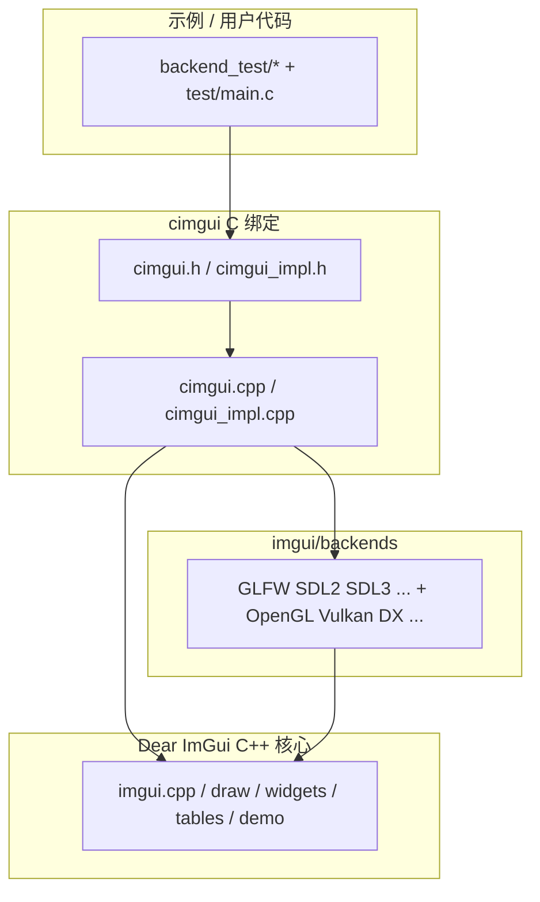

# cimgui 文档图 · Home

> 目标:把手改的 **cimgui** (Dear ImGui 的 C API 绑定) 的 **API** 与 **示例** 整理成一张可导航、可检索的 Obsidian 知识图。
> 事实来源:克隆仓库 `D:\Code\工作区\sui\lyco_imgui\cimgui`（branch `docking_inter`，基于 Dear ImGui **1.92.9b**），并有同步的 **codegraph** 索引（见 [[05 Codegraph 索引]]）。

## 从哪开始

| 想做什么 | 打开 |
|---|---|
| 了解 cimgui 是什么 / 版本 / 组成 | [[01 cimgui 总览]] |
| 所有 API 按分类浏览 | [[10 API 索引]] |
| 函数 → 实现 → 后端 的完整链路 | [[50 调用链专题]] |
| 怎么写一个完整窗口程序 | [[41 示例 主循环模式]] |
| 后端函数怎么封装 | [[31 cimgui_impl 封装层]] |
| 代码里搜符号 / 查调用者 | [[05 Codegraph 索引]] |

## 全景图

## 笔记目录

- **概览** —— [[01 cimgui 总览]] · [[02 仓库结构]] · [[03 架构分层]] · [[04 生成器机制]] · [[05 Codegraph 索引]]
- **API** —— [[10 API 索引]] 及其每个分类页
- **数据结构** —— [[27 数据结构与枚举]]
- **后端** —— [[30 后端总览]] · [[31 cimgui_impl 封装层]]
- **示例** —— [[40 示例总览]] · [[41 示例 主循环模式]]
- **专题** —— [[50 调用链专题]]

## 关键标签

`#cimgui` 全仓库线索 · `#api` 各 API 分类页 · `#backend` 后端页 · `#example` 示例页 · `#代码路径` 记录函数行号位置。