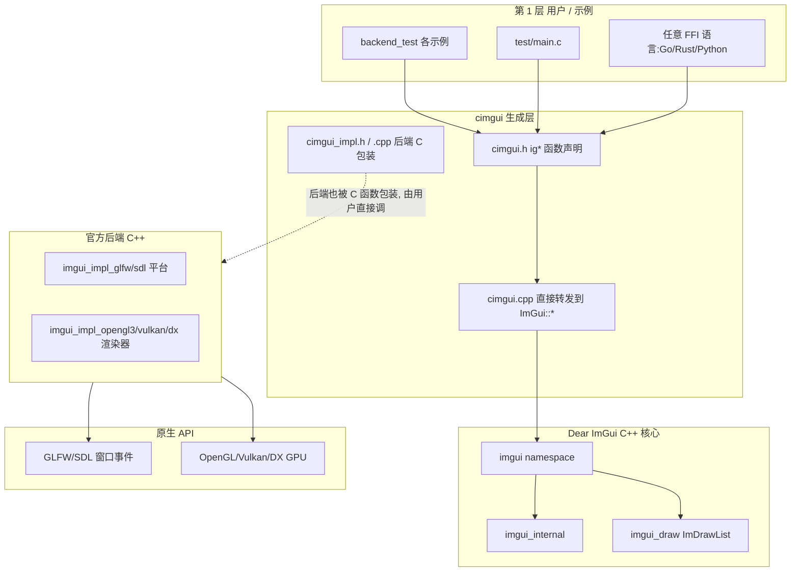
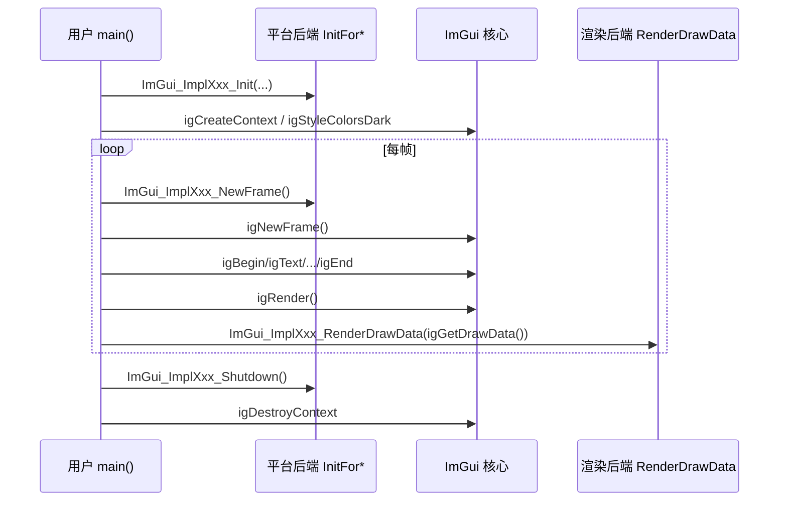

# 架构分层

- 相关:[[00 Home]] · [[02 仓库结构]] · [[50 调用链专题]]

## 分层要点

1. **cimgui.h 只是转发**：`igBegin` 的实体是一行 `return ImGui::Begin(...)`，无业务逻辑；参数类型换成 C 结构体/裸指针（如 `ImGuiIO*`、`ImDrawData*`）。
2. **结构体明文（C 风格）**：`cimgui.h` 里 `ImGuiIO`、`ImGuiStyle`、`ImDrawData` 等被定义成可读写的 C struct（与 Dear ImGui 公有成员一致），在包含前需 `#define CIMGUI_DEFINE_ENUMS_AND_STRUCTS`。
3. **内部 API 可选**：`cimgui.h` 同时绑定了 `imgui_internal.h` 的函数（约 643 个，[[26 API 内部函数]]），是调试/引擎集成的进阶通道。
4. **后端绑定只在宏启用时存在**：`#ifdef CIMGUI_USE_GLFW` 等包裹 `ImGui_Impl*` C 函数（[[31 cimgui_impl 封装层]]）。

## 数据流一次循环

对应 [[41 示例 主循环模式]] 与 [[50 调用链专题]]。