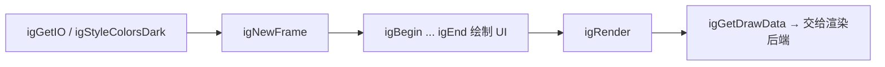

# API 上下文与主循环

- 相关:[[10 API 索引]] · [[12 API 窗口与视图]] · [[41 示例 主循环模式]] · [[03 架构分层]]

本分类 38 个函数:上下文创建/销毁、帧循环（NewFrame/Render）、渲染辅助、DrawData 获取。

## 上下文

| C 函数 | 说明 |
|---|---|
| `igCreateContext(shared_font_atlas)` | 创建全局 ImGuiContext（一个进程通常一个） |
| `igDestroyContext(ctx)` | 销毁；NULL 则重建一份空 context |
| `igGetCurrentContext` / `igSetCurrentContext` | 取/设当前线程上下文（多线程各持实例时用） |
| `igGetVersion` | 返回版本字符串，如 `"1.92.9b"` |
| `igGetTime` / `igGetFrameCount` | 全局时钟与帧计数 |
| `igGetFrameHeight` / `igGetFrameHeightWithSpacing` | 标准行高（含 padding） |
| `igGetTextLineHeight` / `igGetTextLineHeightWithSpacing` | 文本行高 |

## 帧循环

| C 函数 | 说明 |
|---|---|
| `igNewFrame` | **必须每帧第一件事**（在平台后端 NewFrame 之后） |
| `igEndFrame` | 结束界面帧；之后不能再画 UI |
| `igRender` | 结束渲染帧，把 DrawData 呈现到 ImDrawList |
| `igGetDrawData` | 获取待渲染的 `ImDrawData*`（交给渲染后端，如 `ImGui_ImplOpenGL3_RenderDrawData`） |
| `igGetFrameCount` | 同帧循环计数 |

## 渲染辅助（igRender*）

> 这些是 imgui 内部 draw 辅助被绑定后的名字，绘制低层命令列表用，归入 [[22 API 绘制与DrawList]] 更贴切，此处列出以免遗漏:

| C 函数 | 说明 |
|---|---|
| `igRenderArrow` / `igRenderArrowDockMenu` / `igRenderArrowPointingAt` | 箭头图元 |
| `igRenderBullet` / `igRenderCheckMark` | 圆点 / 对勾 |
| `igRenderFrame` / `igRenderFrameBorder` | 带背景/边框的矩形 |
| `igRenderMouseCursor` | 绘制默认鼠标光标 |
| `igRenderNavCursor` | 绘制导航光标 |
| `igRenderPlatformWindowsDefault` | 跨后端渲染平台窗口（配合 `UpdatePlatformWindows`） |
| `igRenderText` / `igRenderTextClipped` / `igRenderTextClippedEx` / `igRenderTextWrapped` / `igRenderTextEllipsis` | 低层文本绘制 |
| `igRenderRectFilledInRangeH` / `igRenderRectFilledWithHole` | 矩形填充辅助 |
| `igRenderColorRectWithAlphaCheckerboard` / `igRenderColorComponentMarker` | 调试用色块 |
| `igRenderDragDropTargetRectEx` / `igRenderDragDropTargetRectForItem` | 拖放目标高亮框 |
| `igInitialize` / `igShutdown` | 初始化/收尾（一般由 Create/Destroy 自动完成） |

## 顺序约束

- 首次调用 `igNewFrame` 前必须先 `igCreateContext`，否则断言失败。
- `igEndFrame` 与 `igRender` 之间不能调用任何 UI 函数。

## 在示例里的落点

- 所有 7 个 backend_test 示例都遵循该顺序（[[40 示例总览]]），最小版本见 [[49 示例 test烟雾测试]]。