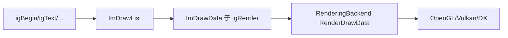

# API 绘制与DrawList

- 相关:[[10 API 索引]] · [[11 API 上下文与主循环]] · [[14 API 样式与字体]] · [[27 数据结构与枚举]] · [[50 调用链专题]]

绘制层 = `ImDrawList`（属于 imgui 输出，跨示例通用）。C 世界里 `ImDrawList` 是普通结构体，**方法被包装成 `ImDrawList_*` 前缀的 C 函数**（struct 方法包装命名 = `StructName_Method`）。

## 结构体方法（ImDrawList_*, 共 73 个成员）

获取当前绘制列表:

```c
ImDrawList* dl = igGetWindowDrawList();          // 当前窗口
ImDrawList* fg = igGetForegroundDrawList();      // 前景层
ImDrawList* bg = igGetBackgroundDrawList();      // 背景层
```

常用命令（方法包装）:

| C 函数（包装后） | 说明 |
|---|---|
| `ImDrawList_AddLine` / `ImDrawList_AddRect` / `ImDrawList_AddRectFilled` | 线/矩形 |
| `ImDrawList_AddPolyline` / `ImDrawList_AddPolygon` | 折线/多边形 |
| `ImDrawList_AddCircle` / `ImDrawList_AddCircleFilled` | 圆 |
| `ImDrawList_AddEllipse` / `ImDrawList_AddEllipseFilled` | 椭圆 |
| `ImDrawList_AddText_StrVec2` / `ImDrawList_AddText_FontPtrVec2` | 文本（str/字体两套组合重载） |
| `ImDrawList_AddImage` / `ImDrawList_AddImageQuad` / `ImDrawList_AddImageRounded` | 图片 |
| `ImDrawList_AddBezierCubic` / `ImDrawList_AddBezierQuadratic` | 贝塞尔 |
| `ImDrawList_AddCallback` / `ImDrawList_AddDrawCmd` | 自定义回调/命令 |
| `ImDrawList_PushClipRect` / `ImDrawList_PushClipRectFullScreen` / `ImDrawList_PopClipRect` | 裁剪 |
| `ImDrawList_PushTextureID` / `ImDrawList_PopTextureID` | 纹理栈 |
| `ImDrawList_Flags`、`ImDrawList_GetClipRectMin/Max`、`ImDrawList_PrimReserve` 等 | 底层细节 |

> 完整 73 个成员名可用 codegraph 看 `ImDrawList` 结构（`codegraph explore ImDrawList AddRect`），或参考 `imgui/imgui_draw.cpp`。

```c
ImDrawList* dl = igGetWindowDrawList();
ImVec2 p = igGetCursorScreenPos();
ImDrawList_AddRectFilled(dl, p, (ImVec2){p.x+100, p.y+20},
                        igGetColorU32(ImGuiCol_Button, 1.0f), 4.0f, ImDrawFlags_None);
ImDrawList_AddText_FontPtrVec2(dl, igGetFont(), igGetFontSize(), p,
                        igGetColorU32(ImGuiCol_Text, 1.0f), "Hello Draw", NULL);
```

## 自由绘制辅助（igRender*，见 [[11 API 上下文与主循环]]）

`igRenderFrame`、`igRenderArrow`、`igRenderText`、`igRenderMouseCursor`、`igRenderRectFilledWithHole` 等也是往 DrawList 写命令的低层 API。

## 输出结构

- `igRender()` 之后用 `igGetDrawData()` 拿 `ImDrawData*`（内含 `CmdLists`、`TotalVtxCount`、`DisplaySize/FramebufferScale`），渲染后端据此生成 GPU 命令（[[30 后端总览]] / [[50 调用链专题]]）。



## 相关

- 几何合成函数（`Im*` 系列，如 `igImMin`、`igImLerp`）见 [[25 API 杂项与调试]]。
- 纹理/字体图集:`io->Fonts` 与 `ImFontAtlas`（[[27 数据结构与枚举]]）。
- 颜色构造用 `igColorConvertFloat4ToU32` 或 `igGetColorU32`（[[14 API 样式与字体]]）。