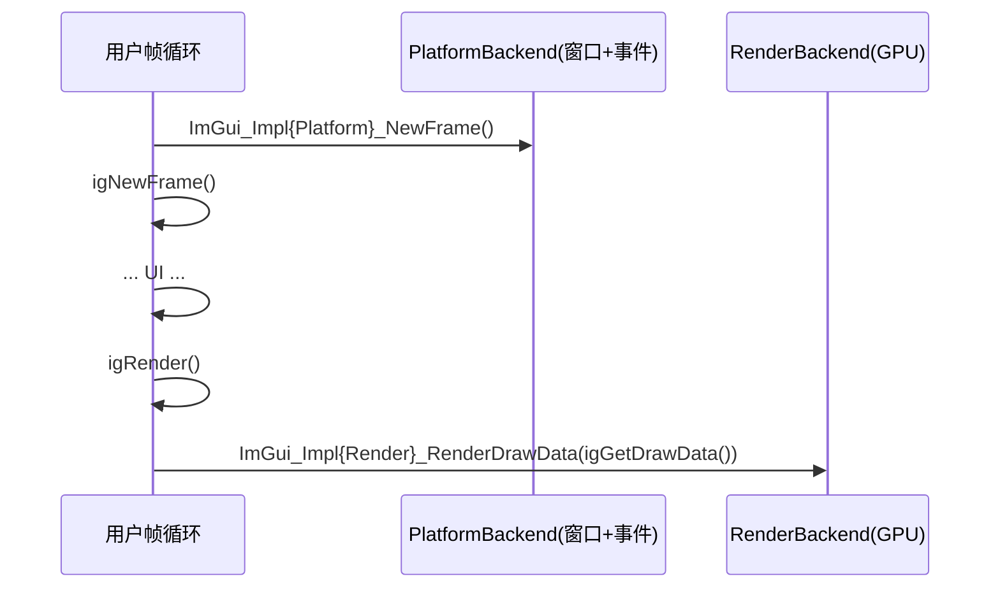

# 后端总览

- 相关:[[00 Home]] · [[31 cimgui_impl 封装层]] · [[40 示例总览]] · [[50 调用链专题]]

Dear ImGui 本身"无渲染、无输入"，靠**平台后端**（窗口/事件）和**渲染后端**（GPU 提交）两件套驱动。官方后端位于 `imgui/backends/`（C++），cimgui 只 C 包装了其中一部分。

## 平台后端（谁提供窗口/输入）

| 后端 | 文件 | cimgui C 包装 | 示例 |
|---|---|---|---|
| GLFW | `imgui_impl_glfw` | ✅ | [[43 示例 GLFW OpenGL3]]、[[44 示例 GLFW DX11]] |
| SDL2 | `imgui_impl_sdl2` | ✅ | [[42 示例 SDL2 OpenGL3]]、[[45 示例 SDL2 Vulkan]]、[[46 示例 SDL3 SDLRenderer3]] |
| SDL3 | `imgui_impl_sdl3` | ✅ | [[47 示例 SDL3 Vulkan]]、[[48 示例 SDL3 SDLGPU3]] |
| Win32 | `imgui_impl_win32` | ❌（需 C++） | — |
| OSX/Metal | `imgui_impl_osx` / `imgui_impl_metal` | ❌ | — |
| GLUT | `imgui_impl_glut` | ❌ | — |
| Android | `imgui_impl_android` | ❌ | — |
| Allegro5 | `imgui_impl_allegro5` | ❌ | — |

## 渲染后端（谁把 ImDrawData 变成三角形）

| 后端 | 文件 | cimgui C 包装 | 备注 |
|---|---|---|---|
| OpenGL3 | `imgui_impl_opengl3` | ✅ | 最常用 |
| OpenGL2 | `imgui_impl_opengl2` | ✅ | 极简/兼容 |
| Vulkan | `imgui_impl_vulkan` | ✅（含 VulkanH helper） | 见 [[36 后端 Vulkan]] |
| DX9 / DX10 / DX11 / DX12 | `imgui_impl_dx*` | ❌ | DX11 示例见 [[44 示例 GLFW DX11]]（示例直接内联 C++? 否——是调 cimgui 公开例子的渲染函数?见下） |
| Metal / Metal4 | `imgui_impl_metal` | ❌ | |
| WGPU | `imgui_impl_wgpu` | ❌ | |
| SDLRenderer2/3 | `imgui_impl_sdlrenderer*` | ❌（示例直接用官方 C++ 渲染后端，见 [[46 示例 SDL3 SDLRenderer3]]） | SDL 软件/2D 渲染 |
| SDLGPU3 | `imgui_impl_sdlgpu3` | ❌ | SDL3 的 GPU 渲染 |

> 关键点:**官方渲染后端不全是 C 可用**。GLFW/SDL2/SDL3/OpenGL2/3/Vulkan 的 C++ 头被转换成 C（在 `cimgui_impl.h`）；而 **DX/Metal/WGPU/SDLRenderer/SDLGPU 后端示例直接在示例工程里用对应 C++ 后端头文件**（backend_test 的每个例子目标链接原始 `imgui_impl_*.cpp`），也就是说示例的"高层后端"是 C++ 官方后端，而 cimgui 负责把 ImGui 核心 API 暴露成 C。

## cimgui_impl 支持的组合（由 `CIMGUI_USE_*` 宏决定）

```c
#define CIMGUI_USE_GLFW
#define CIMGUI_USE_OPENGL3
#include "cimgui_impl.h"
```

可叠加的平台/渲染对（每个组合都在 backend_test 有对照示例）:

| 平台 | 渲染 | 示例笔记 |
|---|---|---|
| GLFW | OpenGL3 | [[43 示例 GLFW OpenGL3]] |
| GLFW | DX11 | [[44 示例 GLFW DX11]] |
| SDL2 | OpenGL3 | [[42 示例 SDL2 OpenGL3]] |
| SDL2 | Vulkan | [[45 示例 SDL2 Vulkan]] |
| SDL3 | SDLRenderer3 | [[46 示例 SDL3 SDLRenderer3]] |
| SDL3 | Vulkan | [[47 示例 SDL3 Vulkan]] |
| SDL3 | SDLGPU3 | [[48 示例 SDL3 SDLGPU3]] |

## NewFrame/RenderDrawData 总管线



各后端函数细节见 [[31 cimgui_impl 封装层]] 及对应后端笔记。