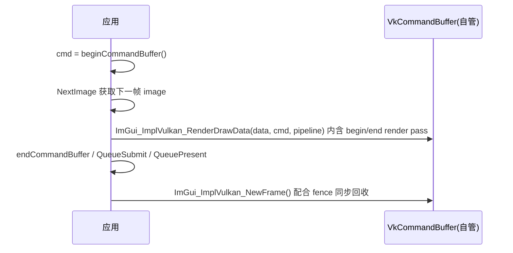

# 后端 Vulkan

- 相关:[[31 cimgui_impl 封装层]] · [[45 示例 SDL2 Vulkan]] · [[47 示例 SDL3 Vulkan]] · [[30 后端总览]]

cimgui 对官方 `imgui_impl_vulkan` 的完整 C 包装（**21 个函数** + 多个 C 结构体），在 `#ifdef CIMGUI_USE_VULKAN` 内；官方 headless helper `imgui_impl_vulkan.h` 也被包装为 **VulkanH** 家族（官方写法即 `ImGui_ImplVulkanH_*`）。Vulkan 是唯一在 cimgui 里带完备 helper 的大后端。

## 结构体（C 表面,字段与 C++ 同名）

| 结构体 | 用途 |
|---|---|
| `ImGui_ImplVulkan_InitInfo` | **初始化输入大结构**:Instance/PhysicalDevice/Device/QueueFamily/Queue/DescriptorPool/ImageCount/MSAA/Pipeline 细节/Allocator/CheckVkResultFn 等 |
| `ImGui_ImplVulkan_PipelineInfo` | 管线创建细节（RenderPass/Subpass/MSAA/动态状态） |
| `ImGui_ImplVulkan_RenderState` | 帧内管线状态（CommandBuffer/Pipeline/Layout） |
| `ImGui_ImplVulkanH_Window` | 交换链辅助:Surface/Swapchain/RenderPass/Frames 数组/FrameSemaphores |
| `ImGui_ImplVulkanH_Frame` | 一帧的 CommandPool/Buffer/Fence/Framebuffer |
| `ImGui_ImplVulkanH_FrameSemaphores` | 每帧 ImageAcquired/RenderComplete 信号量 |

## 核心函数

```c
ImGui_ImplVulkan_InitInfo info = {};       // 填满 Instance/Device/... 
ImGui_ImplVulkan_Init(&info);              // 后端初始化(返回 bool)
...每帧...
ImGui_ImplVulkan_NewFrame();
igNewFrame(); ... UI ...
igRender();
ImGui_ImplVulkan_RenderDrawData(igGetDrawData(), cmd_buffer, pipeline);  // 在自建 CommandBuffer 中提交
ImGui_ImplVulkan_Shutdown();
```

| 函数 | 说明 |
|---|---|
| `ImGui_ImplVulkan_Init / NewFrame / Shutdown` | 生命周期 |
| `ImGui_ImplVulkan_RenderDrawData(draw_data, command_buffer, pipeline)` | 渲染色带在内 —— Vulkan 必须在 CommandBuffer 里插 ImGui 命令（区别于 OpenGL 的全局提交） |
| `ImGui_ImplVulkan_AddTexture / RemoveTexture / UpdateTexture` | 纹理注册（device image/view）与销毁 |
| `ImGui_ImplVulkan_CreateMainPipeline` | 预设主管线（与 InitInfo 的 PipelineInfoMain 配套） |
| `ImGui_ImplVulkan_LoadFunctions(api_version, loader, user_data)` | 手动装载 Vulkan 函数指针（不用静态结链时用） |
| `ImGui_ImplVulkan_SetMinImageCount` | 运行时改 min image count |

## VulkanH（交换链/窗口 helper）

| 函数 | 说明 |
|---|---|
| `ImGui_ImplVulkanH_SelectPhysicalDevice / SelectSurfaceFormat / SelectPresentMode / SelectQueueFamilyIndex` | 设备/格式/呈现模式挑选 |
| `ImGui_ImplVulkanH_CreateOrResizeWindow / DestroyWindow` | 为每个 OS 窗口造/重建交换链框架 |
| `ImGui_ImplVulkanH_GetWindowDataFromViewport(viewport)` | 用 ImGuiViewport 反查 `ImGui_ImplVulkanH_Window*` |
| `ImGui_ImplVulkanH_GetMinImageCountFromPresentMode` | 按 PresentMode 推断最小帧数 |
| `ImGui_ImplVulkanH_Window_ImGui_ImplVulkanH_Window()` | 构造（分配）一个 Window 对象 |

## 每帧结构（配合 WSI 采集）



> Vulkan 细节多，切换成 **VulkanH Window** 模式的完整参考见 [[45 示例 SDL2 Vulkan]]（约 400 行）与 [[47 示例 SDL3 Vulkan]]（同款结构改用 SDL3）。

## 相关

- 载荷/校验:初始化时把 `CheckVkResultFn` 设为你的断言函数，`LoadFunctions` 可避免显式链接 vulkan-1。
- 多窗口/多显示器与 `ViewportsEnable` 组合见 [[23 API IO与输入]]。