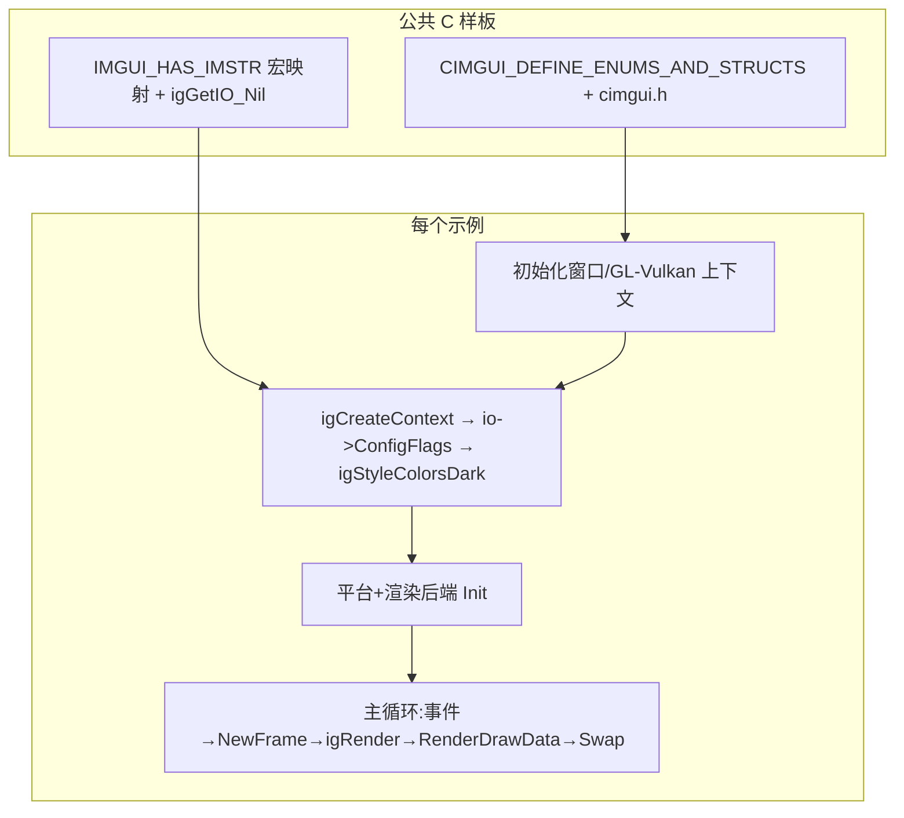

# 示例总览

- 相关:[[00 Home]] · [[41 示例 主循环模式]] · [[30 后端总览]] · [[49 示例 test烟雾测试]]

仓库里的示例分两组:`backend_test/`（7 个真实窗口程序,每种"平台×渲染"组合各一份）和 `test/`（null 后端的无窗口单元级烟雾测试）。**全部是 C 源码**，直接演示 cimgui C API。

## backend_test 7 例一览

| 目录 | 平台 | 渲染 | 后端层 | 笔记 |
|---|---|---|---|---|
| `example_sdl_opengl3` | SDL2 | OpenGL3 | cimgui C 包装 ×2 | [[42 示例 SDL2 OpenGL3]] |
| `example_glfw_opengl3` | GLFW | OpenGL3 | cimgui C 包装 ×2 | [[43 示例 GLFW OpenGL3]] |
| `example_glfw_dx11` | GLFW | DX11 | 平台 C + 渲染 **C++** | [[44 示例 GLFW DX11]] |
| `example_sdl_vulkan` | SDL2 | Vulkan | 平台 C + VulkanH C + 渲染 C++ | [[45 示例 SDL2 Vulkan]] |
| `example_sdl3_vulkan` | SDL3 | Vulkan | 同上 | [[47 示例 SDL3 Vulkan]] |
| `example_sdl_renderer3` | **SDL3** | SDLRenderer3 | 平台 C + 渲染 C++ | [[46 示例 SDL3 SDLRenderer3]] |
| `example_sdlgpu3` | SDL3 | SDLGPU3 | 平台 C + 渲染 C++ | [[48 示例 SDL3 SDLGPU3]] |

> 注意目录名 `example_sdl_renderer3`/`example_sdlgpu3` 体感的"SDL2"实为 SDL3（看 main.c 里的 `ImGui_ImplSDL3_*`）。

## 构建方式

每个示例目录有独立 `CMakeLists.txt`;同时有公共帮助函数 `backend_test/cmake/GenerateCimguiBindings.cmake`（讲解见 [[04 生成器机制]]）:

```cmake
GenerateCimguiBindings(target platbk rendbk inclist)
```

它干三件事:
1. `FetchContent` 拉 cimgui(`docking_inter` 分支,浅克隆)。
2. 若 `cimgui_impl.h` 里没有所需 `CIMGUI_USE_{plat/rend}` 段 → 用 **LuaJIT** 跑 `generator.lua <compiler> internal noimstrv <plat> <rend> <includes>` 重新生成绑定。
3. 把 `cimgui.cpp + cimgui_impl.cpp + imgui_*.cpp + imgui_impl_{plat,rend}.cpp` 编成一个 **SHARED 库**（导出符号;WIN32 用 `__declspec(dllexport)` 宏）。

众示例编译顺利的前提:系统有 **LuaJIT**（生成步骤）、对应平台 SDK（SDL2/SDL3/GLFW/Vulkan/DX11）。

## 公共样板（每个 main.c 开头都有的 C 绑定粘合）

```c
//#define CIMGUI_DEFINE_ENUMS_AND_STRUCTS   // glfw_dx11 在 CMake 里开;其余在 main.c 里开
#include "cimgui.h"
#include "cimgui_impl.h"

#ifdef IMGUI_HAS_IMSTR
#define igBegin igBegin_Str          // ImStrv 版本（见 [[04 生成器机制]]）
#define igSliderFloat igSliderFloat_Str
#define igCheckbox igCheckbox_Str
#define igColorEdit3 igColorEdit3_Str
#define igButton igButton_Str
#endif
#define igGetIO igGetIO_Nil          // 可空 IO 版本推荐
```

## test/ 烟雾测试

`test/main.c` — 无窗口、无平台/渲染后端,直接 `igCreateContext` → `igDebugCheckVersionAndDataLayout` → 一帧 `igNewFrame/igRender` → 摧毁 context。验证绑定与链接正确（[[49 示例 test烟雾测试]]）。

## 画像:示例层级

