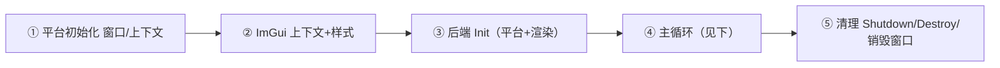

# 示例 主循环模式

- 相关:[[40 示例总览]] · [[11 API 上下文与主循环]] · [[03 架构分层]] · [[50 调用链专题]]

backend_test 每个示例都长同一个骨架。以 **SDL2+OpenGL3**（[[42 示例 SDL2 OpenGL3]]）为主把模式讲清，其余只是"平台/渲染函数名"不同。

## 标准五段



### ① 平台初始化（以 SDL2+GL 为例）

```c
if (SDL_Init(SDL_INIT_VIDEO) != 0) return -1;
SDL_GL_SetAttribute(SDL_GL_CONTEXT_PROFILE_MASK, SDL_GL_CONTEXT_PROFILE_CORE);
SDL_GL_SetAttribute(SDL_GL_CONTEXT_MAJOR_VERSION, 3);
SDL_GL_SetAttribute(SDL_GL_CONTEXT_MINOR_VERSION, 2);
const char* glsl_version = "#version 150";
SDL_Window* window = SDL_CreateWindow(...);
SDL_GLContext gl = SDL_GL_CreateContext(window);
```

### ② ImGui 上下文 + 样式

```c
igCreateContext(NULL);
ImGuiIO* io = igGetIO();                     // 用 igGetIO_Nil 宏展开
io->ConfigFlags |= ImGuiConfigFlags_NavEnableKeyboard;
igStyleColorsDark(NULL);
```

### ③ 后端初始化

```c
ImGui_ImplSDL2_InitForOpenGL(window, gl);    // 平台（cimgui C 包装）
ImGui_ImplOpenGL3_Init(glsl_version);        // 渲染（cimgui C 包装）
```

### ④ 主循环（核心 4 拍）

```c
bool running = true;
while (running) {
    SDL_Event e;
    while (SDL_PollEvent(&e)) {
        ImGui_ImplSDL2_ProcessEvent(&e);     // (a) 平台吃事件
        if (e.type == SDL_QUIT) running = false;
    }
    ImGui_ImplSDL2_NewFrame();               // (b) 平台喂新帧
    igNewFrame();                            // (c) ImGui 新帧
    igShowDemoWindow(1);                      // (d) UI……最终扣回 igRender
    // ...或者自己 igBegin/igEnd 窗口...
    igRender();                              // 结束界面帧,产出 DrawData
    glViewport(0,0,w,h);
    glClearColor(...); glClear(GL_COLOR_BUFFER_BIT);
    ImGui_ImplOpenGL3_RenderDrawData(igGetDrawData());  // 交给 GPU
    SDL_GL_SwapWindow(window);               // 交换缓冲
}
```

### ⑤ 清理

```c
ImGui_ImplOpenGL3_Shutdown();
ImGui_ImplSDL2_Shutdown();
igDestroyContext(NULL);
SDL_GL_DeleteContext(gl); SDL_DestroyWindow(window); SDL_Quit();
```

## 不变式（无论哪套后端）

1. `igNewFrame()` 前必须有 **平台后端 NewFrame**;`igRender()` 后必须有 **渲染后端 RenderDrawData(igGetDrawData())**。
2. `igNewFrame → …UI… → igRender` 缺一不可;UI 期间所有控件都要在 `igBegin/igEnd` 配对内。
3. `io->WantCaptureMouse/Keyboard` 指示是否把输入交 ImGui。

## 变体差异（对应各示例笔记）

| 维度 | 区别 |
|---|---|
| 平台事件 | GLFW 例:安装回调模式 `InitFor*(win, true)`（[[43 示例 GLFW OpenGL3]]）;SDL 例:手动 `ProcessEvent` 转发（[[33 后端 SDL2]]/[[34 后端 SDL3]]） |
| 渲染提交 | OpenGL:全局 `glDraw`;Vulkan:须在自己的 CommandBuffer 里插桩（[[45 示例 SDL2 Vulkan]]）;SDLRenderer:CPU 提交;SDLGPU/DX:命令列表 |
| 交换缓冲 | `SDL_GL_SwapWindow` / `glfwSwapBuffers` / Vulkan `vkQueuePresent` / SDLGPU `Submit` |
| DPI 缩放 | sdl_renderer3 与 vulkan 示例额外处理 `main_scale`（[[46 示例 SDL3 SDLRenderer3]]） |