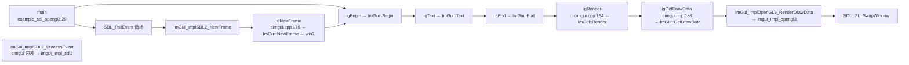
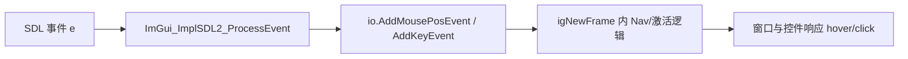

# 调用链专题

- 相关:[[00 Home]] · [[03 架构分层]] · [[05 Codegraph 索引]] · [[41 示例 主循环模式]]

把"从 `main()` 到最终三角形"的完整调用链梳理成一张图，并给出 codegraph 验证命令——这是连接 API 索引（[[10 API 索引]]）与源码实现（`imgui.cpp` 等）的桥梁。

## 端到端调用链（SDL2+OpenGL3 示例）



> 行号来自本代码索引（`codegraph`/`definitions.json`）:
> `igBegin cimgui.cpp:244 · igEnd :248 · igNewFrame :176 · igRender :184 · igGetDrawData :188`
> `igShowDemoWindow :192 · igGetIO_Nil :164 · igCreateContext :148 · igDestroyContext :152 · igGetVersion :228 · igStyleColorsDark :232`

## cimgui 转发层长什么样（cimgui.cpp 一段）

```cpp
CIMGUI_API bool igBegin(const char* name, bool* p_open, ImGuiWindowFlags flags) {
    return ImGui::Begin(name, p_open, (ImGuiWindowFlags)flags);   // 纯转发
}
CIMGUI_API void igNewFrame(void) { ImGui::NewFrame(); }
CIMGUI_API void igRender(void)   { ImGui::Render(); }
CIMGUI_API ImDrawData* igGetDrawData(void) { return ImGui::GetDrawData(); }
```

## 用 codegraph 验证（对应 [[05 Codegraph 索引]]）

```text
codegraph callers igRender
# 8 个调用者,全部是各示例的 main() —— 印证"示例直接驱动核心 API"

codegraph explore "igRender igGetDrawData ImGui_ImplOpenGL3_RenderDrawData"
# 一次调用返回:igRender/igGetDrawData 定义源 + 它们背后的 ImGui::Render 调用路径
```

后端侧包装（[[31 cimgui_impl 封装层]]）同理:

```text
codegraph explore "ImGui_ImplSDL2_NewFrame igNewFrame"
# 看到:SDL2 平台新帧 → 同步 io 状态 → igNewFrame
```

## 事件→输入→导航链



- 想读输入状态:[[23 API IO与输入]] 的 `igIsMouseClicked` 等。
- 想截输入:`io->WantCaptureMouse`。

## 与"文档图"的关系

每个分类页末尾的"相关"都是为了把这棵树连起来:

```
Home → [10 API 索引] → 每个分类笔记 → 具体函数名
     → [40 示例总览] → 每示例笔记 → main() 里调用的具体函数
     → [50 调用链专题](本页) → codegraph 验证行号/调用者
```

数据源头永远是 `generator/output/definitions.json`（函数+重载+location）与 `.codegraph/` 索引（符号+边）。